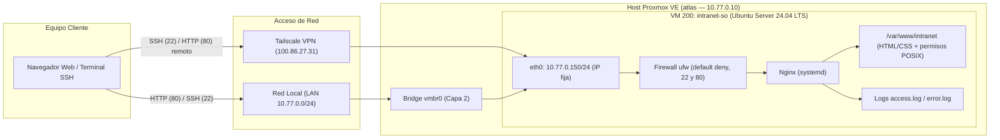

# Despliegue de una Intranet Corporativa en Ubuntu Server

**Asignatura:** Sistemas Operativos
**Evaluación:** Tercera Solemne
**Tema:** Despliegue de un sitio web como intranet institucional sobre Linux

---

## Descripción del proyecto

Este proyecto documenta el despliegue completo de una **intranet corporativa** sobre
**Ubuntu Server**, ejecutándose dentro de una máquina virtual con IP fija. El objetivo
es levantar un sitio web interno (HTML/CSS) servido por un servidor web, con la
administración de usuarios, permisos, firewall y análisis de logs que corresponden a
un entorno de servidor real.

La intranet simula el portal interno de una institución ficticia y es accesible desde
un equipo cliente dentro de la misma red.

### Arquitectura general



---

## Objetivos

- Seleccionar e instalar una distribución Linux de tipo servidor.
- Configurar red con IP fija y verificar conectividad cliente-servidor.
- Instalar y configurar un servidor web con arranque automático gestionado por `systemd`.
- Diseñar y publicar un sitio web institucional con al menos 3 páginas.
- Administrar usuarios, grupos y permisos POSIX con el principio de mínimo privilegio.
- Aplicar seguridad de red mediante firewall con política *default deny*.
- Analizar logs, recopilar evidencias y respaldar la configuración.

---

## Distribución de responsabilidades del equipo

| # | Integrante | Área de responsabilidad |
|---|------------|-------------------------|
| 1 | **Benjamín** | Infraestructura, distribución y red |
| 2 | **Vicente** | Servidor web y `systemd` |
| 3 | **Guille** | Contenido de la intranet |
| 4 | **Simón** | Usuarios, grupos y permisos |
| 5 | **Pía** | Firewall y seguridad de red |
| 6 | **Carlita** | Logs, evidencias y limitaciones |

---

## 1. Infraestructura, distribución y red — *Benjamín*

### Elección de la distribución: Ubuntu Server

Se eligió **Ubuntu Server (LTS)** por las siguientes razones:

- **Soporte extendido (LTS):** 5 años de actualizaciones de seguridad.
- **Comunidad y documentación amplia**, ideal para un entorno académico.
- **Sin entorno gráfico:** menor consumo de recursos, orientado a servidor.
- **Gestor de paquetes `apt`** y repositorios estables.

### Instalación y configuración de la VM (Proxmox VE)

1. Crear la VM (`VMID 200`, `intranet-so`) en **Proxmox VE** (`atlas`) con:
   - **2 vCPU (`host`)**, **2 GB RAM**, **20 GB de disco** (`local-lvm`).
   - Adaptador de red `virtio` en modo **Bridge (`vmbr0`)** sobre la LAN `10.77.0.0/24`.
2. Desplegar **Ubuntu Server 24.04 LTS** usando la Cloud Image oficial + `cloud-init` (ver procedimiento completo y replicable en [`docs/infraestructura-vm.md`](docs/infraestructura-vm.md)).
3. Crear snapshot base (`base-inicial`) en Proxmox y habilitar acceso remoto vía **Tailscale** (`100.86.27.31`).

### Configuración de IP fija (Netplan / cloud-init)

Ubuntu Server usa **Netplan**. Al aprovisionar con `cloud-init` en Proxmox (`ip=10.77.0.150/24,gw=10.77.0.1`), se genera automáticamente `/etc/netplan/50-cloud-init.yaml`:

```yaml
# /etc/netplan/50-cloud-init.yaml
network:
  version: 2
  ethernets:
    eth0:
      dhcp4: no
      addresses:
        - 10.77.0.150/24
      routes:
        - to: default
          via: 10.77.0.1
      nameservers:
        addresses: [8.8.8.8, 1.1.1.1]
```

Verificar la configuración aplicada:

```bash
ip -br a                     # Verificar IP fija 10.77.0.150/24 en eth0
sudo cat /etc/netplan/50-cloud-init.yaml
```

### Demostración de conectividad cliente-servidor

```bash
# Desde el CLIENTE hacia el SERVIDOR (LAN o Tailscale)
ping -c 4 10.77.0.150
ssh <usuario>@100.86.27.31

# Desde el SERVIDOR hacia el gateway
ping -c 4 10.77.0.1
```

---

## 2. Servidor web y `systemd` — *Vicente*

### Comparativa técnica: Nginx vs Apache

| Criterio | **Nginx** | **Apache (httpd)** |
|----------|-----------|--------------------|
| Arquitectura | Asíncrona, orientada a eventos | Basada en procesos/hilos |
| Rendimiento con estáticos | Muy alto | Bueno |
| Consumo de memoria | Bajo | Mayor bajo alta carga |
| Configuración | Centralizada (`nginx.conf`) | Modular + `.htaccess` |
| Casos de uso | Alta concurrencia, reverse proxy | Flexibilidad, módulos dinámicos |

**Decisión:** Para una intranet de contenido mayormente **estático (HTML/CSS)**, se
recomienda **Nginx** por su bajo consumo y eficiencia. *(Ambas opciones son válidas;
se documenta la elección tomada.)*

### Instalación del servicio

```bash
sudo apt update
sudo apt install -y nginx
```

### Configuración del VirtualHost (server block)

```nginx
# /etc/nginx/sites-available/intranet
server {
    listen 80;
    server_name intranet.local 10.77.0.150;

    root /var/www/intranet;
    index index.html;

    location / {
        try_files $uri $uri/ =404;
    }

    access_log /var/log/nginx/intranet_access.log;
    error_log  /var/log/nginx/intranet_error.log;
}
```

Activar el sitio y recargar:

```bash
sudo ln -s /etc/nginx/sites-available/intranet /etc/nginx/sites-enabled/
sudo rm -f /etc/nginx/sites-enabled/default    # Deshabilitar sitio por defecto
sudo nginx -t                                  # Validar sintaxis
sudo systemctl reload nginx
```

### Verificación del arranque automático (systemd)

```bash
sudo systemctl enable nginx      # Habilitar inicio automático en el arranque
sudo systemctl start nginx
sudo systemctl status nginx      # Verificar estado: active (running)
systemctl is-enabled nginx       # Debe devolver: enabled
```

---

## 3. Contenido de la intranet — *Guille*

### Institución ficticia

**"Instituto Tecnológico Austral"** — portal interno para funcionarios, con acceso a
noticias, directorio de contactos y recursos internos.

### Estructura del sitio (mínimo 3 páginas)

```
/var/www/intranet/
├── index.html         # Página de inicio / bienvenida
├── contacto.html      # Directorio y datos de contacto
├── recursos.html      # Recursos internos y enlaces
└── css/
    └── estilos.css    # Hoja de estilos común
```

### Publicación del contenido

```bash
sudo mkdir -p /var/www/intranet/css
# Copiar los archivos HTML/CSS al directorio
sudo cp -r sitio/* /var/www/intranet/
```

El sitio debe incluir navegación entre las 3 páginas y una hoja de estilos CSS común
que dé identidad visual a la institución (logo, colores, cabecera y pie de página).

---

## 4. Usuarios, grupos y permisos — *Simón*

### Creación del grupo y usuario editor (sin `sudo`)

```bash
# Grupo de editores de la intranet
sudo groupadd editores

# Usuario editor SIN privilegios administrativos
sudo useradd -m -s /bin/bash -G editores editor_intranet
sudo passwd editor_intranet
```

> El usuario **no** se agrega al grupo `sudo`, por lo que no puede ejecutar comandos
> administrativos (principio de **mínimo privilegio**).

### Configuración de permisos POSIX sobre `/var/www/intranet`

```bash
# El grupo editores es dueño del directorio del sitio
sudo chown -R root:editores /var/www/intranet

# Permisos: dueño rwx, grupo rwx, otros r-x
sudo chmod -R 775 /var/www/intranet

# setgid: los archivos nuevos heredan el grupo editores
sudo chmod g+s /var/www/intranet
```

### Demostración del bloqueo de comandos administrativos

```bash
# Iniciar sesión como editor_intranet y probar:
whoami                       # editor_intranet
sudo systemctl restart nginx # -> "editor_intranet is not in the sudoers file"

# En cambio, SÍ puede editar el contenido del sitio:
nano /var/www/intranet/index.html   # permitido por pertenecer a 'editores'
```

---

## 5. Firewall y seguridad de red — *Pía*

### Configuración de `ufw` con política *default deny*

```bash
sudo apt install -y ufw

# Política por defecto: denegar todo lo entrante, permitir lo saliente
sudo ufw default deny incoming
sudo ufw default allow outgoing
```

### Apertura exclusiva de los puertos necesarios

```bash
sudo ufw allow 22/tcp      # SSH (administración)
sudo ufw allow 80/tcp      # HTTP (intranet)

sudo ufw enable            # Activar el firewall
sudo ufw status verbose    # Verificar reglas aplicadas
```

Resultado esperado:

```
Status: active
Default: deny (incoming), allow (outgoing)

To                         Action      From
--                         ------      ----
22/tcp                     ALLOW       Anywhere
80/tcp                     ALLOW       Anywhere
```

Cualquier otro puerto queda **bloqueado** por la política *default deny*.

---

## 6. Logs, evidencias y limitaciones — *Carlita*

### Análisis de `access.log` y `error.log`

```bash
# Ver accesos en tiempo real
sudo tail -f /var/log/nginx/intranet_access.log

# Contar respuestas por código de estado
sudo awk '{print $9}' /var/log/nginx/intranet_access.log | sort | uniq -c | sort -rn
```

### Códigos de estado a evidenciar

| Código | Significado | Cómo provocarlo |
|--------|-------------|-----------------|
| **200 OK** | Petición exitosa | Acceder a `http://10.77.0.150/index.html` |
| **403 Forbidden** | Acceso denegado por permisos | Quitar el permiso de lectura para `www-data` a un archivo y solicitarlo |
| **404 Not Found** | Recurso inexistente | Acceder a `http://10.77.0.150/noexiste.html` |

Para el **403** se usa una copia de prueba, de modo que el sitio real no quede inutilizado
durante la demostración. Nginx se ejecuta como `www-data`, que no es dueño del archivo
ni pertenece al grupo `editores`; por eso basta con quitarle el permiso de lectura a
*otros* (`o-r`):

```bash
# 403: copia de prueba sin lectura para "otros" (www-data)
sudo cp /var/www/intranet/recursos.html /var/www/intranet/demo-403.html
sudo chmod o-r /var/www/intranet/demo-403.html

curl -I http://10.77.0.150/demo-403.html     # HTTP/1.1 403 Forbidden
sudo tail -n 5 /var/log/nginx/intranet_error.log  # ... Permission denied

# Limpiar la evidencia y dejar el sitio intacto
sudo rm -f /var/www/intranet/demo-403.html
```

> Si se quitara el permiso al archivo real (`index.html`), el sitio dejaría de cargar
> hasta restaurar los permisos; por eso la prueba se hace sobre una copia desechable.

```bash
# Errores del servidor
sudo tail -n 50 /var/log/nginx/intranet_error.log
```

### Respaldo de la configuración y el sitio

```bash
# Respaldo del sitio y de la configuración de nginx
sudo tar -czvf respaldo_intranet_$(date +%F).tar.gz \
    /var/www/intranet \
    /etc/nginx/sites-available/intranet
```

### Entrega final

- Recopilar capturas de pantalla como evidencia de cada etapa.
- Elaborar la presentación final.
- **Subir la presentación a Blackboard** dentro del plazo establecido.

---

## Limitaciones conocidas

- La intranet usa **HTTP sin cifrado**; en producción debería implementarse HTTPS (TLS).
- El acceso está restringido a la **red local**, no está expuesto a Internet.
- Contenido **estático**: no hay backend ni base de datos.
- La IP fija depende de la configuración de red del entorno de virtualización.

---

## Tabla resumen de comandos clave

| Tarea | Comando |
|-------|---------|
| Aplicar red | `sudo netplan apply` |
| Instalar servidor web | `sudo apt install -y nginx` |
| Validar config | `sudo nginx -t` |
| Habilitar arranque | `sudo systemctl enable nginx` |
| Crear usuario editor | `sudo useradd -m -G editores editor_intranet` |
| Firewall deny | `sudo ufw default deny incoming` |
| Abrir puertos | `sudo ufw allow 80/tcp` |
| Ver logs | `sudo tail -f /var/log/nginx/intranet_access.log` |
| Respaldo | `sudo tar -czvf respaldo.tar.gz /var/www/intranet` |

---

## Integrantes

- Benjamín — Infraestructura, distribución y red
- Vicente — Servidor web y `systemd`
- Guille — Contenido de la intranet
- Simón — Usuarios, grupos y permisos
- Pía — Firewall y seguridad de red
- Carlita — Logs, evidencias y limitaciones

---

## Trabajo realizado por Guille

- Se creó el sitio estático dentro de `sitio/`, con `index.html`, `contacto.html` y `recursos.html`, siguiendo la estructura indicada en la sección de contenido.
- Se añadió `sitio/css/estilos.css` como hoja de estilos común, con navegación relativa entre las páginas.
- Se usó contenido ficticio y no se añadieron recursos dependientes de Internet.
- Se comprobaron los enlaces internos y que las tres páginas y la hoja de estilos respondan correctamente en una prueba local. El despliegue en Ubuntu Server queda pendiente.
- El 404 de demostración se obtiene solicitando una ruta inexistente; no requiere agregar una página rota al sitio.

---

## Trabajo realizado por Benjamín

- Se dimensionaron los recursos necesarios para hostear el sitio estático de `sitio/` (`24 KB`) y se aprovisionó la VM **`intranet-so`** (`VMID 200`) en Proxmox VE (`atlas`) con **Ubuntu Server 24.04 LTS**, `2 vCPU`, `2 GB RAM` y `20 GB` de disco (`local-lvm`).
- Se configuró la red en modo **Bridge (`vmbr0`)** con **IP fija `10.77.0.150/24`** (gateway `10.77.0.1`, DNS `8.8.8.8 / 1.1.1.1`) mediante `cloud-init` / Netplan, verificando conectividad bidireccional (`ip a`, `ping`) y acceso SSH.
- Se creó el snapshot base **`base-inicial`** y el snapshot final **`final-listo`** en Proxmox (`atlas`) una vez completadas y verificadas todas las etapas del equipo.
- Se instaló **Tailscale** (`100.86.27.31`) y se habilitaron usuarios individuales con acceso SSH para cada integrante del equipo (`vicente`, `guille`, `simon`, `pia`, `carlita`), dejando la VM limpia sin `nginx` para que cada rol ejecute su parte.
- Se documentó el análisis de recursos, la comparativa Ubuntu Server vs Debian, la topología de red, el despliegue replicable y el guion de demo en vivo en [`docs/infraestructura-vm.md`](docs/infraestructura-vm.md).

---

## Trabajo realizado por Vicente

- Se instaló **Nginx 1.24.0** en la VM `intranet-so` y se configuró el server block en `/etc/nginx/sites-available/intranet` apuntando a `/var/www/intranet`, deshabilitando el sitio `default`.
- Se desplegó el contenido de `sitio/` en `/var/www/intranet/`, se validó la sintaxis con `nginx -t` y se habilitó el arranque automático mediante `systemd` (`systemctl is-active nginx` → `active`, `systemctl is-enabled nginx` → `enabled`).

---

## Trabajo realizado por Simón

- Se creó el grupo **`editores`** (`gid 1006`) y el usuario **`editor_intranet`** (`uid 1006`) **sin privilegios `sudo`** (*principio de mínimo privilegio*: `User editor_intranet is not allowed to run sudo on intranet-so`).
- Se configuraron los permisos POSIX sobre `/var/www/intranet` con propietario `root:editores`, permisos `775` y bit **SGID (`g+s`)** (`drwxrwsr-x`), verificando la edición del contenido (`index.html`) y el bloqueo de comandos administrativos.

---

## Trabajo realizado por Pía

- Se configuró y activó el firewall **`ufw`** con política por defecto **`deny (incoming)`** y **`allow (outgoing)`**, habilitando exclusivamente los puertos **`22/tcp`** (SSH) y **`80/tcp`** (HTTP) en IPv4 e IPv6.
- Se verificaron las reglas activas (`ufw status verbose`) y las pruebas de conectividad de puerto permitido (`80/tcp`) frente a puerto bloqueado (`8080/tcp`).

---

## Trabajo realizado por Carlita

- Se revisaron y evidenciaron los logs de Nginx (`/var/log/nginx/intranet_access.log` y `/var/log/nginx/intranet_error.log`), registrando respuestas **`200 OK`**, **`403 Forbidden`** (mediante archivo temporal de prueba sin permisos de lectura, posteriormente eliminado) y **`404 Not Found`**.
- Se generó el respaldo comprimido del sitio y de la configuración de Nginx (`tar -czvf`) y se incorporó la copia final actualizada en [`respaldos/respaldo_intranet_2026-11-26.tar.gz`](respaldos/respaldo_intranet_2026-11-26.tar.gz).
